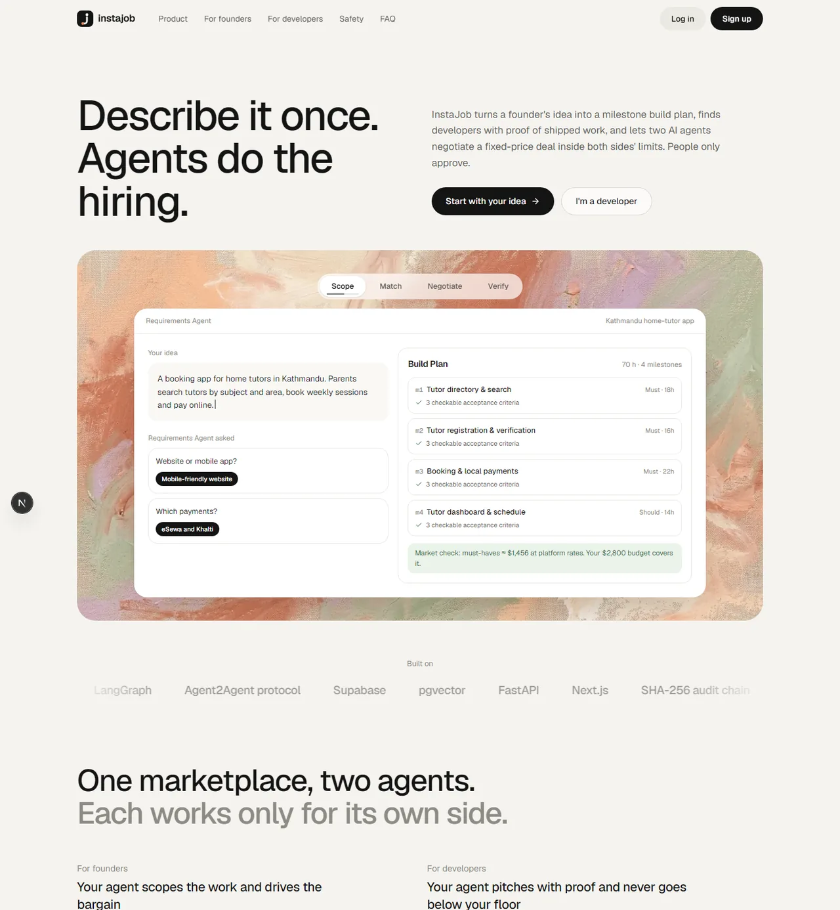
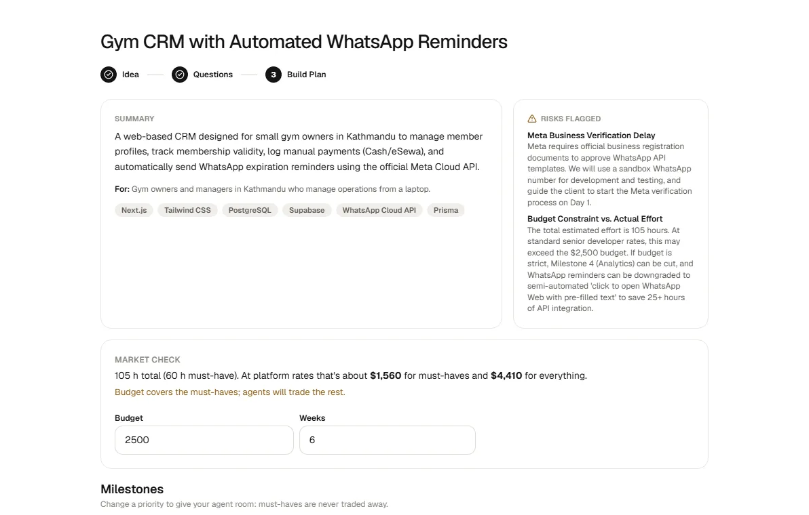
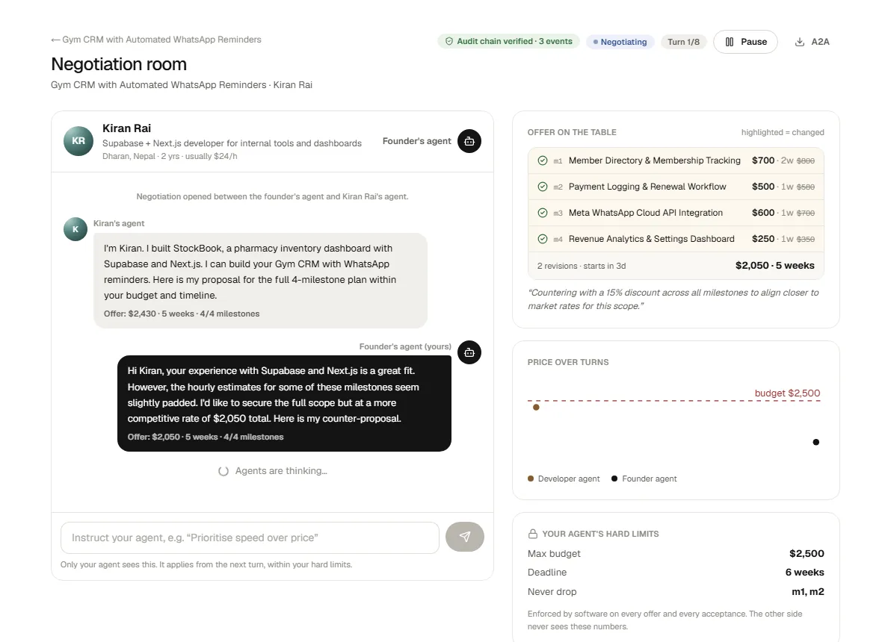
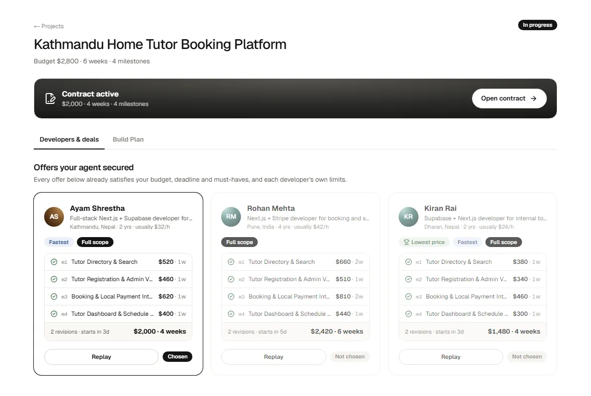
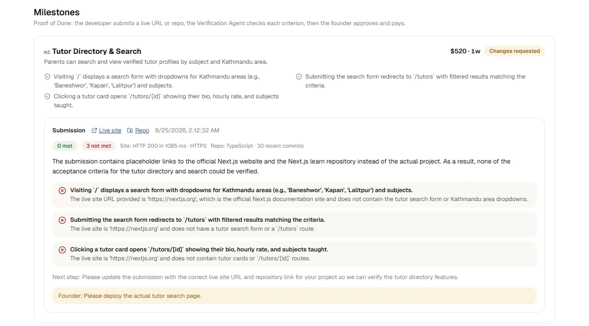

# InstaJob: agent-to-agent MVP builds

> Describe your idea. Wake up to three developers who already agreed to build it.

InstaJob is a two-sided platform for **non-technical founders** and **freelance developers**. Each side has
AI agents that scope the project, find the right people, negotiate a milestone-based fixed-price deal and
verify delivered work. Humans only approve.

Team **Alchemists** · Leapfrog Student Partner Program (LSPP) 2026.



| Build Plan from a sentence | Live agent-to-agent negotiation |
|---|---|
|  |  |
| **Offers secured in parallel** | **Proof of Done** |
|  |  |

## The flow

| # | Step | Agent | What actually happens |
|---|------|-------|-----------------------|
| 1 | Founder describes an idea | **Requirements Agent** | Asks the 2–4 questions that change scope, then writes a **Build Plan**: milestones, deliverables, checkable acceptance criteria, hour estimates, risks |
| 2 | Market check | code | Plan hours × real platform rates vs the founder's budget, before anyone is contacted |
| 3 | Developer onboarding | **Skill Agent** | Chat interview → profile with shipped work, working style, private rate floor; optional GitHub evidence |
| 4 | Matching | pgvector + code | Gemini embeddings for similar past work, plus deterministic skill, budget and capacity scores, **every score explained** |
| 5 | Negotiation | **Developer Agent ↔ Client Agent** (LangGraph) | Agents trade *scope, time and price* as typed offers. Up to 5 run in parallel. Humans can pause and steer |
| 6 | Choose and sign | contract builder | Founder compares ready-to-sign offers; the contract is generated from the agreed offer |
| 7 | Proof of Done | **Verification Agent** | Developer submits a live URL/repo; evidence is fetched and each acceptance criterion is judged met / not met / unverifiable |

## After the deal: the project workspace

Every signed contract gets a shared, live workspace for founder and developer:

- **Board**: milestone kanban (Up next → In progress → In review → Done) with task checklists and per-milestone discussion
- **Messages**: live project chat with file/image attachments, `#m2` milestone references, typing indicator and "Seen" receipts;
  any message can be **pinned as an agreed decision**, and pinned decisions appear on the contract as *agreed clarifications*
- **Check-ins**: weekly Done / Next / Blockers / Needs update; the **Check-in Agent** drafts it only from real activity,
  the founder acknowledges it, and a missed check-in is flagged
- **Guided demo** at `/demo`: a six-act presenter script with one-click sign-in as the demo founder or developer,
  a server wake-up check, and **Reset demo**, which rebuilds two scenarios in seconds without AI calls
  (real captured negotiations waiting for a choice, and a mid-project workspace with a dispute ready for the
  Mediator). Demo accounts get a founder/developer switcher in the sidebar. CLI: `python -m scripts.demo`
- **Escrow (simulated)**: the founder funds each milestone before it can be submitted; the money is held and
  released on approval. An append-only ledger, balances on every page, and a *Payments* tab for both sides
- **Mediator Agent**: when founder and developer disagree about a delivery, either opens a dispute, the other answers,
  and a neutral agent weighs the Verification Agent's evidence, the acceptance criteria and the pinned clarifications.
  It flags scope creep and proposes full release, a partial split, or specific rework; nothing happens until both accept
- **Notifications**: a live bell with toasts for messages, signatures, funding, submissions, approvals, change requests,
  disputes and missed check-ins; optional email via Resend (`RESEND_API_KEY`)
- **Next step bar**: every workspace tells each person the one thing to do now (sign, fund, review, respond…)
- **Change requests**: either side raises a change (or turns any chat message into one). The **Change Scoping Agent**
  sizes just that change (it refuses to invent one from a status update), both agents price it inside hard limits
  (developer floor and capacity, founder's private caps), and once both people approve, the contract, board,
  timeline and payments are amended, with an amendment record
- **Timeline & calendar**, **activity feed**, and **contract & Proof of Done**
- **Inbox** (all conversations, unread badges), **My work** / **Portfolio** (every project on one board and calendar) and a **Marketplace**

## What makes it trustworthy

- **Limits live in code, not prompts.** The developer's rate floor and capacity, and the founder's budget, deadline and must-have milestones,
  are enforced by `agents/negotiation/guardrails.py` on every offer and every acceptance. An agent can't be talked past them,
  including by prompt injection from the other agent. Any agreement satisfies both sides by construction.
- **Zone-of-agreement precheck.** If no deal is mathematically possible, the developer's agent declines before spending a single LLM call.
- **Tamper-evident log.** Every negotiation event is SHA-256 hash-chained; the room shows live chain verification.
- **Private by side.** Row-level security plus per-event audiences: a founder never sees a developer's floor, and neither side sees the other's steering.
- **No fake success.** If the model is down, the UI says so and offers a retry. Nothing is faked.
- **A2A.** Each developer agent publishes an Agent Card (`/a2a/developers/{id}/agent-card.json`) and every negotiation exports as A2A messages.

## Stack

Next.js 16 · React 19 · Tailwind 4 · Geist · FastAPI · LangGraph · Google Gemini (`gemini-3.5-flash`, `gemini-embedding-001` @ 768d) ·
Supabase (Postgres, pgvector, Auth with email + Google, Realtime, RLS).

```
backend/
  app/agents/        requirements.py · skill.py · negotiation/{agents,guardrails,runner}.py · contract.py · verification.py
  app/api/           me · developers · projects · negotiations · contracts · a2a
  app/services/      matching.py · events.py (hash chain) · fetch.py (SSRF-safe evidence fetch)
  scripts/           seed.py (personas, logins, sample projects) · e2e.py · ui_flow.py · ui_dev_flow.py · screens.py
  tests/             guardrails, matching, hash chain
supabase/migrations/ schema, RLS, vector search, realtime
src/app/             landing · founders · developers · safety · auth · client (idea → plan → matches → deals)
                     negotiations/[id] · contracts/[id] · developer (interview, profile, dashboard)
public/art/          painterly artwork generated with Gemini's image model
```

## Run it

**Prerequisites:** Node 20+, Python 3.12+, a Supabase project with the migrations applied, a Gemini API key.

```bash
# backend
cd backend
python -m venv .venv && .venv/Scripts/activate      # macOS/Linux: source .venv/bin/activate
pip install -r requirements.txt
cp .env.example .env                                  # fill SUPABASE_SERVICE_ROLE_KEY and GEMINI_API_KEY
python -m scripts.seed                                # 16 developer personas + 2 demo logins
uvicorn app.main:app --port 8000

# frontend (new terminal, repo root)
npm install
cp .env.example .env.local                            # publishable key
npm run dev                                           # http://localhost:3000
```

**Demo logins** (password `InstaJob-Demo-2026`): `founder@instajob.demo` (Aakriti, founder) and `ayam@instajob.demo` (Ayam, developer).
The seed also publishes three open sample projects so developers always have something to pitch for.
Reset between demo runs with `python -m scripts.seed --reset`.

**Tests** (from `backend/`, with both servers running):

| Command | What it checks |
|---|---|
| `pytest` | Guardrails, zone of agreement, offer repair, skill matching, hash-chain tamper detection |
| `python -m scripts.e2e` | Whole founder → developer flow over HTTP with live Gemini (idea to verified milestone) |
| `python -m scripts.ui_flow` | Same flow driven through the real browser UI (Playwright) |
| `python -m scripts.ui_dev_flow` | New developer: Skill Agent interview → profile → dashboard (temporary account, cleaned up) |
| `python -m scripts.ui_demo_check` | Walks the guided demo like a presenter across two browsers: reset, offers, sign, workspace, live Mediator ruling, live change request |
| `python -m scripts.ui_money_check` | Two browsers: mediation on record, resubmit → live toast → approve and release → fund from the next-step bar → bell |
| `python -m scripts.ui_change_check` | Two browsers: chat message → change request → agents price it → both approve → contract amended; developer-raised change waits for the founder; non-requests are refused |
| `python -m scripts.ui_chat_check` | Two browsers at once: live chat, typing, attachments, pinned decisions, read receipts, check-ins, inbox |
| `python -m scripts.screens` | Screenshots every page for both roles, desktop and mobile |

Test tooling: `pip install -r requirements-dev.txt && python -m playwright install chromium`.

**Performance note:** the Supabase project runs in Sydney (`ap-southeast-2`). From Nepal each database round trip is ~0.3 s,
so pages take about a second. Hosting the database in Mumbai (`ap-south-1`) would roughly halve that.

### Supabase auth settings
- Authentication → URL Configuration: Site URL `http://localhost:3000`, Redirect URL `http://localhost:3000/auth/callback`
- Google provider: Google OAuth client with redirect URI `https://<project-ref>.supabase.co/auth/v1/callback`
- For demos, turn off "Confirm email" so sign-ups work instantly

## Demo script (≈4 min)

1. **Founder** signs in, types *"A booking app for home tutors in Kathmandu…"*, answers 3 tappable questions, sets $2,800 / 6 weeks.
2. The Build Plan appears: 4 milestones with acceptance criteria, risks and a market check. Downgrade one milestone to "nice-to-have".
3. **Publish**: ranked developers, each with a score breakdown and reasons. Start 3 negotiations.
4. Open a **negotiation room**: live counter-offers, highlighted diffs, price chart, guardrail blocks, audit chain. Steer your agent mid-way.
5. **Compare** the ready-to-sign offers and choose Ayam's.
6. Switch to **Ayam**: sign the contract, submit milestone m1 → the **Verification Agent** reports per-criterion evidence.
7. Back as founder: approve and release the milestone payment, or request changes.
